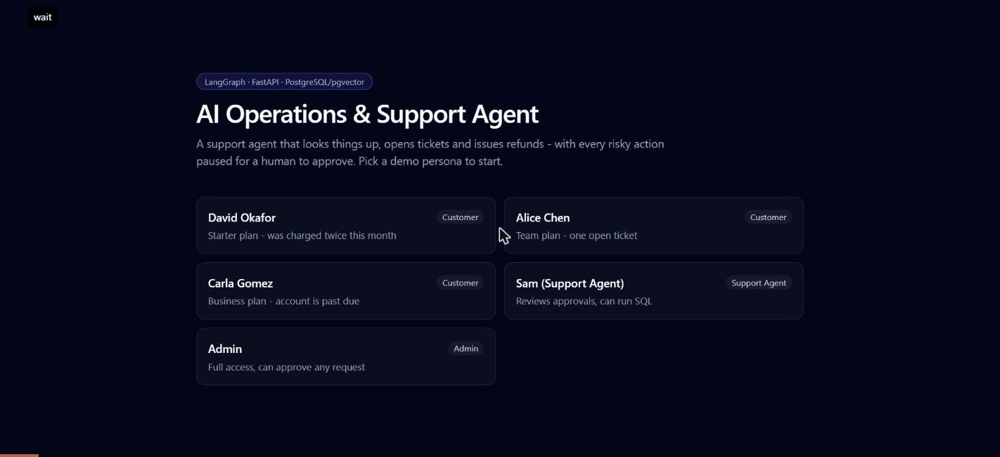

# AI Operations & Support Agent


A **LangGraph** agent that runs multi-step customer-support workflows. It uses tools for knowledge
retrieval, customer lookup, read-only SQL, ticket creation and updates, refunds and human
escalation. Write actions pause for **human approval**, guardrails screen every request and reply,
and an **evaluation harness** tracks task success, latency, tokens and cost. It is served by
**FastAPI** on **PostgreSQL + pgvector**.

It runs on **free LLM tiers only**: Google Gemini (primary), Groq (automatic fallback) or Ollama
(fully local). A built-in offline model lets the whole stack, tests and CI run with no API key.

## Operator console demo



The **Next.js operator console** ([`web/`](web/)) streams agent replies over SSE with every tool call
shown live, pauses write actions in an **Approvals** queue for a human, and tracks outcomes, p50/p95
latency, tokens and cost on a **Metrics** page. In the demo above, the customer's refund request
triggers `lookup_customer` and `search_knowledge_base`, then `issue_refund` pauses for approval; the
support agent approves it and the LangGraph run resumes and issues the refund.

## Results

Measured on the 31-scenario evaluation dataset (`ops-agent eval`) with **Gemini 3.5 Flash-Lite
on the free tier**:

| Metric | Result |
|---|---|
| Task success (all checks pass, including DB side effects) | **100%** (31/31) |
| Tool selection accuracy | **100%** |
| Median latency per task (p50) | **2.5 s** |
| Average LLM calls per task | 2.2 |
| Average tokens per task | ~4.2k |
| Cost | **$0** (free tier) |

The first run scored **94%**. The eval showed that the agent opened *urgent tickets* instead of
escalating security incidents and chargeback threats, which left the customer waiting for an
approval. Tightening the tool contracts (system prompt + `create_ticket` description) fixed it.
Both reports are in [`evals/results/`](evals/results/). The p95 latency (16 s) is dominated by
free-tier rate-limit waits; the agent switches models automatically when that happens
(3.5-flash-lite → 3.6-flash → 3.8-flash → Groq).

```
                    ┌──────────── FastAPI (X-API-Key auth, RBAC) ────────────┐
 customer / staff → │ /v1/chat  /v1/chat/stream (SSE)  /v1/approvals  /metrics│
                    └───────────────────────────┬─────────────────────────────┘
                                                │ AgentService (threads, runs, approvals)
   ┌────────────────────────────── LangGraph StateGraph ─────────────────────────────────┐
   │ guard_input ─► agent (LLM + tools) ─► route ─┬─► tools ───────────────► agent …      │
   │   │ injection / PII                          │                                       │
   │   └─► END (blocked)                          └─► request_approval ─► await_approval  │
   │                                                    (interrupt) ─approve─► tools     │
   │ agent ─(final answer)─► guard_output ─► END            └─reject─► agent             │
   └──────────── state checkpointed in Postgres (AsyncPostgresSaver) ────────────────────┘
        │                    │                         │
   pgvector + FTS      business tables          agent_runs / audit_log
   (hybrid RAG)     (customers, invoices…)     (latency, tokens, cost)
```

## Features

| Area | What's implemented |
|---|---|
| **Agent workflow** | LangGraph state machine with conditional routing, a per-turn step limit, and history trimming that never splits tool-call pairs. Threads are persisted with `AsyncPostgresSaver`, so conversations survive restarts and resume after approval. |
| **Tools** (8) | `search_knowledge_base`, `lookup_customer`, `get_ticket`, `run_sql_query`, `create_ticket`, `update_ticket`, `issue_refund`, `escalate_to_human` |
| **Tool-input validation** | Each tool has a strict Pydantic schema (patterns, ranges, cross-field rules). Validation and business errors go back to the model so it can correct itself. |
| **Retries & idempotency** | `RetryPolicy` with exponential backoff on transient DB/network errors. Write tools are idempotent on the `tool_call_id`, so a retried step never creates a duplicate ticket or refund. LLM calls fall back to the next provider (`with_fallbacks`). |
| **Human-in-the-loop** | A risk-based policy (refunds, closing tickets, urgent priority; or `APPROVAL_MODE=all_writes`) persists an approval request and pauses with `interrupt()`. A reviewer approves or rejects via the API and the run resumes. The four-eyes rule blocks self-approval. The refund tool *also* refuses to run without a recorded approval. |
| **Retrieval** | Markdown-aware chunking. Local embeddings via `fastembed` (bge-small, free). **Hybrid search** combines pgvector cosine similarity with Postgres full-text search, merged by Reciprocal Rank Fusion. Answers carry `[slug#section]` citations. |
| **Safe SQL** | Three layers: (1) a `sqlglot` AST guard (single SELECT only, allow-listed tables, no `pg_*`/dangerous functions, enforced `LIMIT`); (2) a read-only transaction with a statement timeout; (3) a SELECT-only Postgres role. Staff only, and every query is audit-logged. |
| **Guardrails** | Weighted prompt-injection detection (blocked before any LLM call). PII redaction: Luhn-checked card numbers, SSN, IBAN, passwords, CVV. A system-prompt leak **canary** is checked on output. Customer data scoping is enforced inside every tool. |
| **Observability** | A callback tracker records latency, LLM calls, tokens, models used, and per-tool timing and errors into `agent_runs`. `/v1/metrics/summary` reports outcome mix, p50/p95 latency, tool failure rates and cost. Optional LangSmith tracing. |
| **Evaluation** | 31-case YAML dataset across knowledge, account, tickets, refunds, escalation, operations/SQL, security and guardrails. Checks cover tool trajectory, final status, reply content, **DB side effects** (e.g. "the refund row exists"), guardrail flags, and an optional LLM-as-judge. Reports are written as Markdown and JSON. |
| **Quality gates** | 57 pytest tests (unit + integration on a real Postgres), ruff, and GitHub Actions CI running a smoke eval that must pass at 100%. |

## Quick start

**Prerequisites:** Docker, plus Python 3.11+ for local development.

### 1. Get a free API key (optional, but needed for real LLM answers)
- **Gemini:** https://aistudio.google.com/apikey (Google account, no card)
- **Groq (fallback):** https://console.groq.com/keys

```powershell
Copy-Item .env.example .env   # then paste GEMINI_API_KEY / GROQ_API_KEY
```
Without keys, set `LLM_PROVIDER=fake` to use the deterministic offline model.

### 2. Run everything in Docker
```powershell
docker compose up -d --build
```
The **operator console** starts on http://localhost:3000 and the API on http://localhost:8000
(interactive docs at http://localhost:8000/docs). The first start creates the schema, seeds demo
data and indexes the knowledge base.

### 3. Or run locally (Python venv)
```powershell
docker compose up -d db
python -m venv .venv; .venv\Scripts\Activate.ps1
pip install -e ".[dev]"
ops-agent init-db          # schema + demo data + KB index (idempotent)
ops-agent chat --user alice   # interactive terminal demo (approve refunds inline)
ops-agent serve            # API on http://127.0.0.1:8000
```
Console (separate terminal):
```powershell
cd web; npm install; npm run dev   # http://localhost:3000
```
Postgres is exposed on host port **55432**, to avoid clashing with a local Postgres on 5432.

## Demo users (development only)

| User | Role | API key | Notes |
|---|---|---|---|
| alice | customer (CUS-1001) | `demo-alice-key` | Team plan, one open ticket |
| carla | customer (CUS-1003) | `demo-carla-key` | Business plan, **past due** |
| david | customer (CUS-1004) | `demo-david-key` | **Charged twice** (INV-1004-03 / -04) |
| sam | support_agent | `demo-agent-key` | Approves actions, can run SQL |
| admin | admin | `demo-admin-key` | |

## API walkthrough: a refund with human approval

```powershell
$david = @{ "X-API-Key" = "demo-david-key" }
$sam   = @{ "X-API-Key" = "demo-agent-key" }

# 1. Customer asks for a refund -> agent pauses for approval
$r = Invoke-RestMethod -Method Post http://localhost:8000/v1/chat -Headers $david -ContentType application/json `
     -Body '{"message":"I was charged twice. Please refund the duplicate invoice INV-1004-04 ($19)."}'
$r.status          # awaiting_approval
$r.approval        # approval_id, tool call, risk reason

# 2. Support agent reviews the queue and approves -> the agent run resumes and the refund executes
Invoke-RestMethod http://localhost:8000/v1/approvals -Headers $sam
Invoke-RestMethod -Method Post "http://localhost:8000/v1/approvals/$($r.approval.approval_id)/decision" `
     -Headers $sam -ContentType application/json -Body '{"decision":"approve"}'

# 3. Operational metrics
Invoke-RestMethod http://localhost:8000/v1/metrics/summary -Headers $sam
```

| Endpoint | Description |
|---|---|
| `POST /v1/chat` | One agent turn: `{message, thread_id?}` → reply, status, approval, metrics |
| `POST /v1/chat/stream` | SSE events: `thread`, `token`, `tool_calls`, `tool_result`, `done` |
| `GET /v1/threads`, `GET /v1/threads/{id}` | Conversation list and history (owner-scoped) |
| `GET /v1/approvals?status=pending` | Approval queue (staff) |
| `POST /v1/approvals/{id}/decision` | `{decision: approve\|reject, note?}` resumes the paused run |
| `GET /v1/tickets`, `GET /v1/tickets/{id}` | Tickets with event history (customer-scoped) |
| `GET /v1/metrics/summary`, `GET /v1/runs` | Success mix, p50/p95 latency, tokens, cost, tool stats |

## Evaluation

```powershell
ops-agent eval                          # full dataset on the configured provider
ops-agent eval --tags smoke             # deterministic subset (used by CI)
ops-agent eval --filter refund --judge  # subset + LLM-as-judge grading
```
Each run resets the demo data and writes `evals/reports/<timestamp>_<provider>.md` and `.json`.
The reports include task success rate, tool-selection accuracy, pass rate per category,
p50/p95 latency, average LLM calls per task, tokens and estimated cost. The runner waits 4s
between cases on real providers to stay inside free-tier rate limits (`--delay` changes this).

Free tiers cost $0. Set `PRICE_INPUT_PER_MTOK` / `PRICE_OUTPUT_PER_MTOK` to estimate what the same
traffic would cost at paid list prices.

## Testing

```powershell
docker compose up -d db
pytest            # 57 tests; integration tests use a separate <db>_test database
ruff check app evals tests
```

## Configuration

All settings come from environment variables or `.env` (see `.env.example`). The key ones:

| Variable | Default | |
|---|---|---|
| `LLM_PROVIDER` | `gemini` | `gemini` \| `groq` \| `ollama` \| `fake` |
| `LLM_FALLBACKS` | `groq` | comma-separated providers tried on error or rate limit |
| `GEMINI_MODEL` / `GROQ_MODEL` / `OLLAMA_MODEL` | `gemini-3.5-flash-lite` / `openai/gpt-oss-120b` / `qwen3:8b` | |
| `APPROVAL_MODE` | `risk_based` | or `all_writes` |
| `REFUND_MAX_USD` | `500` | above this the agent must escalate |
| `MAX_AGENT_STEPS` | `10` | LLM calls per turn before stopping |
| `EMBEDDING_PROVIDER` | `fastembed` | `hash` for tests |

## Project layout

```
app/
  agent/      graph.py (LangGraph), service.py (threads/approvals/streaming), policy.py,
              guardrails.py, prompts.py, context.py (RBAC)
  tools/      knowledge, customers, tickets, refunds, escalation, sql + sql_guard
  rag/        chunking, embeddings (fastembed / hash), ingest, hybrid search (pgvector + FTS + RRF)
  api/        FastAPI app, routes, auth, CORS
  observability/tracker.py   latency / token / cost / tool tracing
  llm.py      provider factory + fallbacks;  llm_fake.py  offline models
  bootstrap.py  schema, read-only role, deterministic demo data
db/schema.sql
data/kb/      help-center articles (knowledge base)
evals/        datasets/support_v1.yaml, runner.py, reports/
tests/        unit + integration tests
web/          Next.js 16 operator console (chat with SSE streaming, approvals, tickets, metrics)
```

## Design notes

- **Approval as two nodes.** `request_approval` writes the DB row, then `await_approval` calls
  `interrupt()`. LangGraph re-runs the interrupted node on resume, so keeping the side effect in a
  separate node means the approval request is never inserted twice.
- **Defence in depth.** The tools never trust the graph: customer scoping, staff-only SQL and
  "refunds need a recorded approval" are enforced inside each tool, as well as by routing and by
  which tools are bound to the model for each role.
- **Errors split by who can fix them.** Validation and business errors go back to the model as
  tool results so it can correct itself. Infrastructure errors raise, so LangGraph's
  `RetryPolicy` retries the node.
- **Streaming and output guardrails.** Tokens are streamed as they are generated. The final
  `done` event carries the output-guardrailed reply, and clients should render that as final.
